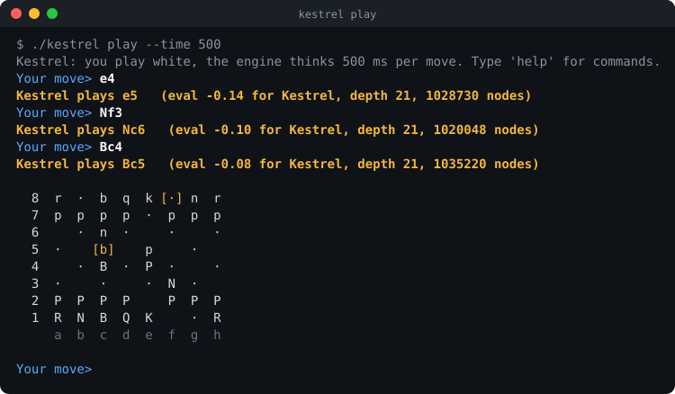

# Kestrel: a chess engine in C++

[](https://github.com/pMag11-alt/kestrel-chess/actions/workflows/ci.yml)


Kestrel is a chess engine written from scratch in about 2,800 lines of C++17, with no dependencies
beyond the standard library. It speaks the **Universal Chess Interface (UCI)**, so it plugs into any
chess GUI (Cute Chess, Arena, BanksiaGUI, lichess-bot), and it has a terminal mode for playing it
directly.

It plays strong, tactical chess. In a 40-game match at 10 s + 0.1 s per game, it scored
**32/40 (+28 =8 −4) against Stockfish 19 limited to `UCI_Elo 2500`**. [Strength](#strength) has
the full results and what they do and don't mean.


<sub>A short game in the terminal. The board is printed after every move; the earlier ones are trimmed here.</sub>

## Quick start

```bash
git clone https://github.com/pMag11-alt/kestrel-chess.git
cd kestrel-chess
make                  # builds ./kestrel (needs a C++17 compiler: g++ or clang++)
./kestrel play        # you play white; add --black to switch sides, --time 2000 for a stronger engine
```

Type moves in standard notation (`e4`, `Nf3`, `O-O`, `exd5`, `e8=Q`) or UCI notation (`e2e4`).
`hint`, `undo`, `moves`, `flip` and `help` work too.

To use Kestrel in a GUI, add `./kestrel` as a UCI engine. You can also drive it by hand:

```console
$ ./kestrel
position startpos moves e2e4 e7e5 g1f3
go depth 12
info depth 1 seldepth 3 score cp 1 nodes 44 nps 44000 time 0 pv b8c6
...
info depth 11 seldepth 20 score cp -60 nodes 15244 nps 3048800 time 5 pv b8c6 d2d4 e5d4 f3d4 g8f6 b1c3 d7d6 f1b5 c8d7 d4c6 d7c6
info depth 12 seldepth 17 score cp -46 nodes 19555 nps 2793571 time 7 pv b8c6 d2d4 e5d4 f3d4 g8f6 b1c3 c6d4 d1d4 d7d6 f1b5 c7c6
bestmove b8c6 ponder d2d4
```

Other modes:

```bash
./kestrel bench                     # fixed-depth search over 10 positions; prints a node-count signature
./kestrel perft 6                   # move-generator check: 119,060,324 positions at depth 6
./kestrel perft 4 "r3k2r/p1ppqpb1/bn2pnp1/3PN3/1p2P3/2N2Q1p/PPPBBPPP/R3K2R w KQkq - 0 1"
./kestrel "position startpos" "go movetime 1000"   # UCI commands as arguments, then exit
```

## How it works

### Board representation (`bitboard.*`, `position.*`, `movegen.*`)

- **Bitboards.** There is one 64-bit mask per piece type and colour, plus a 64-square mailbox for
  "what's on this square?" lookups.
- **Magic bitboards for sliding pieces.** Rook and bishop attacks come from a multiply-and-shift
  hash of the blocking pieces into precomputed tables (107,648 entries). The magic numbers are
  searched for at startup with a seeded PRNG, so every run gets the same ones. This takes about
  0.1 s.
- **16-bit moves.** Each move packs from (6 bits), to (6 bits) and a 4-bit flag that encodes
  capture, promotion piece, castling and en passant. This makes "is it a capture?" a single
  bit test.
- **Make/unmake with a state stack.** It stores castling rights, en passant square, halfmove clock,
  captured piece and an incrementally updated **Zobrist hash**. The en passant square is only
  recorded when a capture is actually possible, so identical positions always hash the same.
- **Move generation.** It produces pseudo-legal moves, and a move is legal if the mover's king isn't
  attacked after making it. This runs at about **92 million perft nodes per second** on an Apple
  M3.

### Search (`search.*`, `tt.*`)

- **Search framework.** Iterative deepening with aspiration windows, around a negamax alpha-beta
  search with principal variation search (null-window probes, full re-search only when needed).
- **Transposition table.** It stores scores with bounds, the best move and the static eval. Mate
  scores are stored relative to the node, so a mate found on one path is scored correctly
  through any transposition.
- **Quiescence search.** At the horizon, only captures and promotions are searched, with stand-pat,
  delta pruning, and static exchange evaluation (SEE, including x-rays) to skip losing captures.
- **Selectivity.**
  - Null-move pruning, disabled when only pawns are left because of zugzwang.
  - Reverse futility pruning, futility pruning and late move pruning.
  - Late move reductions, using a log(depth)·log(move number) table adjusted for history,
    killers, checks and an "improving" signal.
  - Internal iterative reductions, check extensions and mate distance pruning.
- **Move ordering.** Hash move first, then winning captures (MVV-LVA, SEE ≥ 0), two killer moves, a
  countermove, history scores with "gravity", and finally losing captures and under-promotions.
- **Draw rules.** Twofold repetition inside the search tree, threefold against the game history,
  the fifty-move rule and insufficient material.
- **Time management.** Soft and hard limits derived from the clock, increment and moves to go. The
  search runs on its own thread, so UCI `stop` takes effect immediately.

### Evaluation (`eval.*`)

The evaluation is hand-written and *tapered*: every term has a middlegame and an endgame value,
blended by how much material is left. It covers:

- material and piece-square tables
- mobility, counted on squares not attacked by enemy pawns
- bishop pair, and rooks on open and half-open files
- pawn structure: doubled, isolated and passed pawns, where passed pawns gain value with rank and
  with king proximity in the endgame
- king shelter and a king-attack score
- a tempo bonus
- **endgame knowledge:** pawnless positions with a small material edge are scaled toward a draw,
  as are opposite-coloured bishop endings. A "mop-up" term drives a lone king to the edge, so
  K+Q v K and K+R v K are actually converted.

`eval` prints the breakdown for the current position.

## Testing

```bash
make test                          # 38 unit tests, ~534,000 checks, about a second
pip install chess && python3 tests/uci_test.py ./kestrel   # 9 integration tests
make sanitize                      # the unit tests under AddressSanitizer + UBSan
```

The unit tests (`tests/test_main.cpp`) cover:

- **Move generation.** 20 perft positions are checked against published node counts: the 6
  standard Chess Programming Wiki positions, plus 14 that each target one rule (en passant that
  exposes the king, castling through check, promotions, stalemate).
- **Make/unmake.** Every node of a depth-3 tree is checked to restore the exact position, and the
  incremental hash is checked against one computed from scratch.
- **Attack tables.** Magic lookups are compared against slow ray-walking on 2,000 random
  occupancies.
- **Evaluation symmetry.** Every test position, mirrored with colours swapped, must score exactly
  the same.
- **Search.** Mates in 1 to 3 are found, and the chosen move is confirmed by an independent
  brute-force mate solver. The tests also cover: avoiding stalemate, converting K+Q v K, taking a
  repetition draw when losing and avoiding it when winning, the fifty-move rule, time and node
  limits, and determinism.
- **Notation and the UCI front end.** SAN disambiguation, `position`/`go`/`setoption`, error
  handling, and `stop` during `go infinite`.

The integration tests (`tests/uci_test.py`) drive the real binary through
[python-chess](https://python-chess.readthedocs.io/), an independent UCI client and rules
implementation. They compare perft results against python-chess on 60 random positions, play full
games against a random mover, check mate-score reporting, and stop infinite analysis.

CI runs everything with gcc and clang on Ubuntu, clang on macOS, and under AddressSanitizer, UBSan
and ThreadSanitizer.

## Strength

Matches against [Stockfish 19](https://stockfishchess.org/) with its strength limiter, played with
`scripts/match.py` on an Apple M3. The games cycle through 10 balanced openings, and each opening
is played with both colours.

| Opponent                  | Time control | Games | Result         | Score |
|---------------------------|--------------|------:|----------------|------:|
| Stockfish 19, UCI_Elo 1600 | 5 s + 0.05 s |     8 | +8 =0 −0       |  100% |
| Stockfish 19, UCI_Elo 2200 | 5 s + 0.05 s |    20 | +18 =1 −1      | 92.5% |
| Stockfish 19, UCI_Elo 2500 | 10 s + 0.1 s |    40 | +28 =8 −4      |   80% |
| Stockfish 19, UCI_Elo 2700 | 5 s + 0.05 s |    20 | +9 =10 −1      |   70% |

These numbers are not a rating. Stockfish's limiter is calibrated at slower time controls, and very
fast games favour a lean, fast-searching engine. What the table does show is that Kestrel plays
sound chess: in the 40-game match it never lost on time or made an illegal move. Full-strength
Stockfish is in another league: it scored 5.5/6 against Kestrel at 5 s + 0.05 s. To reproduce:

```bash
pip install chess
python3 scripts/match.py --opponent stockfish --elo 2500 --games 40 --tc 10+0.1
```

## Project layout

| File | What it does |
|------|--------------|
| `src/types.h` | Squares, pieces, the 16-bit move encoding, bit tricks |
| `src/bitboard.*` | Attack tables and magic bitboard generation |
| `src/position.*` | Board state, FEN, make/unmake, Zobrist hashing, SEE, draw detection |
| `src/movegen.*` | Pseudo-legal and legal move generation, perft |
| `src/eval.*` | Tapered evaluation and the `eval` breakdown |
| `src/search.*` | Iterative deepening, alpha-beta, quiescence, move ordering, time management, `bench` |
| `src/tt.*` | Transposition table |
| `src/notation.*` | SAN output and parsing, game-over detection |
| `src/uci.*` | UCI protocol (search on a background thread) and the terminal game |
| `tests/` | C++ unit tests and python-chess integration tests |
| `scripts/match.py` | Engine-vs-engine matches with an Elo estimate |

## Limitations

- The search is single-threaded (no Lazy SMP).
- The evaluation is hand-tuned, with no NNUE and no automated parameter tuning. That is where most
  of the remaining strength would come from.
- There is no pondering, opening book, endgame tablebases or Chess960 support.

## License

[MIT](LICENSE)
